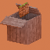
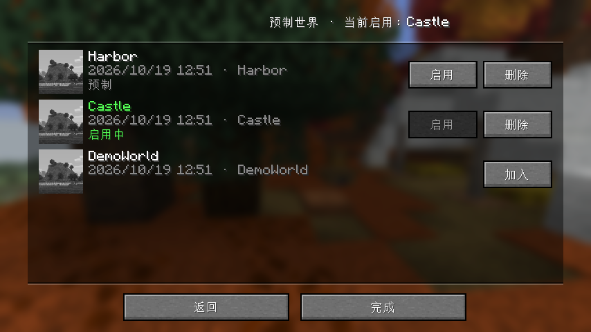
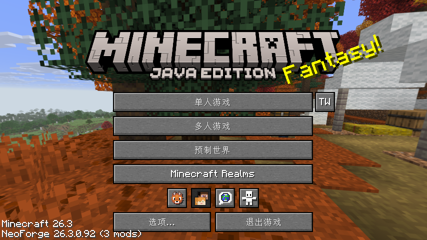

<div align="center">



# Prefab World

**Drop a map into a folder — every world you create from then on is generated from it.**<br>
Built for mapmakers, modpack authors and server owners. No command blocks, no datapacks.

[](https://modrinth.com/mod/prefabworld)
[](#compatibility)
[](#compatibility)
[](LICENSE)

**[中文](README.md) | [English](README_EN.md)**

### [⬇ Download on Modrinth](https://modrinth.com/mod/prefabworld)



<sub>Manager screen: icon, name and last-played time per row, with Use / Delete or Add on the right</sub>

</div>

## What problem it solves

Mapmakers and modpack authors keep running into the same chore: every test world, every player's fresh start, has to be filled with the same spawn area, the same starting island, the same tutorial lobby — built again from scratch.

Prefab World turns that into a single step: **prepare the map once, and every new world starts from it.**

## How it works

1. Install the mod (client and server side).
2. Put your template map — a normal world save folder — into the `prefab_saves` folder inside your instance directory.
3. Create a new world as usual.

The new world is generated with your template's terrain and structures. Want a different starting layout? Swap the template folder.

```text
.minecraft/
└── prefab_saves/
    ├── .active            # remembers which template is active
    ├── OldCastle/
    │   ├── level.dat
    │   └── region/
    └── StarterIsland/
        ├── level.dat
        └── region/
```

With a **single** template in the folder it is activated automatically; with several, pick one in the manager screen or with `/prefab use <name>`.

## Who it's for

| Role | What you use it for |
|------|--------------------|
| Mapmakers | A consistent starting area for every new playthrough — easier to test and ship |
| Modpack authors | Custom spawn, starter island or tutorial area in every new world |
| Server owners | A ready-made lobby, starter plot or event arena before you open the server |

## Features

| Feature | What it does |
|---------|--------------|
| **Plug and play** | One save folder, no config to write |
| **In-game manager** | Add saves to the prefab list, activate or delete them with a click |
| **Server commands** | `/prefab` does the same on dedicated servers |
| **Selective copying** | Player data, progress, world icon and `level.dat` are each toggleable |
| **World rule overrides** | Force the game mode and whether commands are allowed |
| **Invisible to players** | The manager entry is hidden by default |
| **No dependencies** | Runs on its own |

## Manager screen

Set `showManageButton` to `true` in the config and a **Prefabs** button appears on the title screen, right below Multiplayer.

<div align="center">

</div>

It opens a list of your saves:

- Each row shows the world icon, name, last played time and save id
- **Regular saves** have an **Add** button — copies the save into the prefab folder
- **Prefabs** have **Use / Delete** buttons
- The active prefab is shown in green with an "ACTIVE" marker

<div align="center">

</div>

## Commands

For admins (permission level 2):

| Command | Description |
|---------|-------------|
| `/prefab list` | List all prefabs and mark the active one |
| `/prefab use <name>` | Activate a prefab |
| `/prefab add <save>` | Copy a save from `saves/` into the prefab folder |
| `/prefab remove <name>` | Delete a prefab |

Arguments are tab-completed and support names with spaces, including Chinese characters. A typical flow:

```text
/prefab add OldCastle   # copy the save "OldCastle" into the prefab folder
/prefab use OldCastle   # activate it
/prefab list            # confirm what is active
```

## Configuration

The config lives in `config/prefabworldmod-local.toml`, or use **Mods → Prefab World → Config** in game.

| Option | Default | Description |
|--------|---------|-------------|
| `folderName` | `prefab_saves` | Folder that holds the prefab saves |
| `showManageButton` | `false` | Show the manager button on the title screen |
| `overwriteLevelDat` | `false` | Copy the template's `level.dat` (world name, time, …) |
| `copyPlayerData` | `false` | Copy `players/` (inventories, positions, ender chests) |
| `copyPlayerProgress` | `false` | Copy statistics and advancements |
| `copyIcon` | `true` | Copy the world icon |
| `copyDimensions` | `true` | Copy mod dimension chunks (`dimensions/`) |
| `copySavedData` | `true` | Copy mod world data (`data/`, except stats and advancements) |
| `copyDatapacks` | `true` | Copy datapacks (`datapacks/`) |
| `defaultGameMode` | `KEEP` | Force a game mode: `KEEP` / `SURVIVAL` / `CREATIVE` / `ADVENTURE` / `SPECTATOR` |
| `allowCommands` | `KEEP` | Allow commands: `KEEP` / `ENABLED` / `DISABLED` |

Why these defaults: a prefab is a map, so players should start clean — player data and progress are not copied. The icon is copied so every new world shows the same preview image. Game mode and commands follow whatever was picked when creating the world.

## Compatibility

| Version | Loader | Status |
|---------|--------|--------|
| 26.3 | NeoForge 26.3.0.92+ | ✅ Supported (current) |
| 1.20.1 | Forge | Legacy, no longer updated |
| 1.18.2 | Forge | Legacy, no longer updated |

**Installation**: install Minecraft 26.3 and NeoForge 26.3.0.92 or newer, drop the `.jar` into `mods`, launch the game (requires Java 25).

> NeoForge only for now. Fabric is not planned; ask in Issues if you need it — enough requests and we'll add it.

## FAQ

<details>
<summary><b>My new world still has normal terrain.</b></summary>

Check that the template folder sits directly inside `prefab_saves` in your instance directory, and that it is an extracted save folder, not a zip. Use `/prefab list` or the manager screen to confirm it is active.

</details>

<details>
<summary><b>Does it work on multiplayer servers?</b></summary>

Yes. The server and every client need the same version installed.

</details>

<details>
<summary><b>Will it overwrite my existing worlds?</b></summary>

No. It only affects worlds created after installation; existing worlds are untouched.

</details>

<details>
<summary><b>Why is there no Prefabs button on the title screen?</b></summary>

So that regular players never see it — the entry is off by default. Turn on `showManageButton` in the config.

</details>

<details>
<summary><b>Do players inherit the map author's inventory?</b></summary>

No, player data is not copied by default. Set `copyPlayerData` to `true` if you want it.

</details>

<details>
<summary><b>Can I use a template for some worlds and not others?</b></summary>

Every new world uses the currently active template. Existing worlds are unaffected.

</details>

## Upgrading from 1.x

- An existing `preset_world` folder is recognised automatically as the active prefab
- The data folder is still `prefab_saves`, configurable through `folderName`
- The manager entry is off by default and must be enabled

## Feedback

Open an [Issue](https://github.com/Stryde01/Prefabworld/issues). English or Chinese, both are fine. Include your game version and a crash log if you have one.

## License

All Rights Reserved — see [LICENSE](LICENSE). If you want to redistribute it or bundle it into your own pack, please open an Issue first.

---

<div align="center">
<sub>Made for mapmakers and modpack authors.</sub>
</div>
